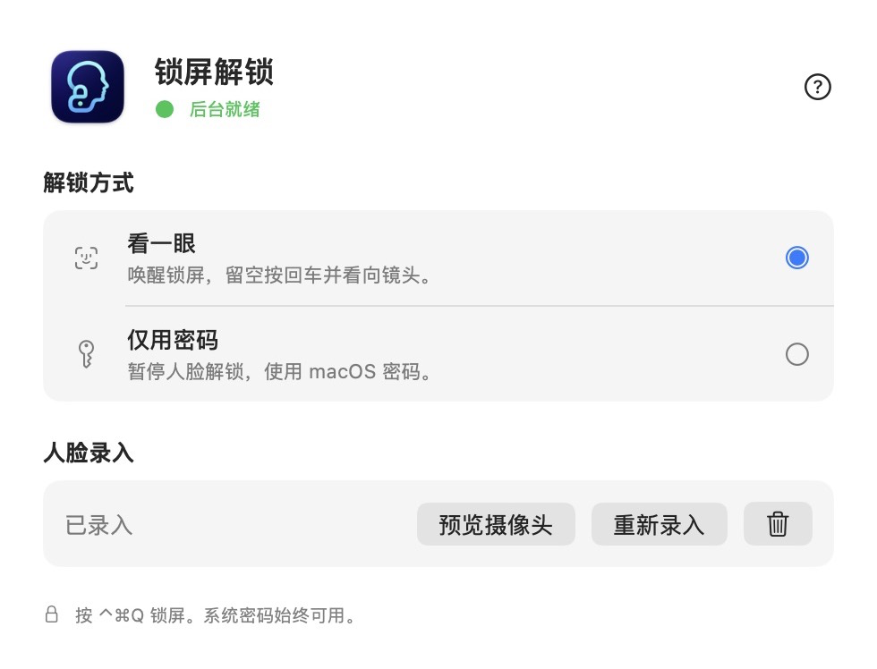

<p align="center">
  
</p>

<h1 align="center">MacFace</h1>

<p align="center"><strong>用人脸解锁 macOS 原生锁屏。</strong></p>

<p align="center">
  Apple 芯片 · macOS 27 · 本机人脸识别 · MIT
</p>

<p align="center">
  <a href="https://github.com/gycodex/MacFace/releases/tag/v1.0.0"><strong>下载 MacFace 1.0.0</strong></a>
  &nbsp;·&nbsp;
  <a href="#开始使用">开始使用</a>
  &nbsp;·&nbsp;
  <a href="#从源码构建">从源码构建</a>
</p>

<p align="center">
  
</p>

## 开始使用

1. 从 [Release](https://github.com/gycodex/MacFace/releases/tag/v1.0.0) 下载 `.pkg`。安装包内含 App、后台和识别模型，无需安装开发工具。
2. 从「应用程序」打开 MacFace，允许摄像头权限，点「录入人脸」并确认保存。安装和保存录入需要管理员授权。
3. 按 `⌃⌘Q` 锁屏。唤醒屏幕后，**在空白密码框按回车并看向镜头**。输入正确的系统密码时，macOS 仍可直接解锁。

菜单栏人像图标可以打开设置、查看后台状态或切换「看一眼」和「仅用密码」。设置里的 `？` 有简短说明。

> [!IMPORTANT]
> 安装包未签名、未公证，macOS 可能拦截打开。支持范围为 Apple 芯片、macOS 27 和外接 UVC 摄像头。已有版本的用户请先[卸载](#卸载)再安装。

## 解锁与隐私

| 操作 | MacFace 的行为 |
| --- | --- |
| 原生锁屏亮起 | 「看一眼」模式会短暂预热摄像头并提前识别。识别持续通过时，最多等待 10 秒 |
| 空白密码框按回车 | 先走人脸验证，核对新画面后解锁 |
| 输入密码 | 交由 macOS 验证；正确密码可直接解锁 |
| 选择「仅用密码」 | 暂停人脸解锁 |

人脸特征保存在本机。摄像头画面只在内存中处理，设置里可以重新录入或删除人脸。普通摄像头不提供 TrueDepth 深度和红外信息，软件活体检测尚未经过完整的照片和视频防冒用评估。

MacFace 用于已登录会话的锁屏。已在 macOS 27.2.1 的 Apple 芯片 Mac mini 和外接 UVC 摄像头上实测。安装包尚未在干净系统完成首次安装与卸载验收。

## 从源码构建

在 Apple 芯片 Mac 上安装 Xcode、CMake 3.25 或更高版本和 Ninja。构建会下载并校验 OpenCV 源码及模型。

```sh
make test
make package
```

安装包和 SHA-256 校验文件生成在 `build/packages/`。直接使用本地构建组件安装时，执行以下命令，然后打开 MacFace 录入人脸。

```sh
sudo /bin/bash build/local-install/install-macface.sh install "$PWD/build/local-install" "$(id -un)"
```

<details>
<summary>实现概览</summary>

- SwiftUI 和 AVFoundation 提供设置、预览和录入。
- 后台使用 YuNet、人脸特征模型 SFace 和 MiniFASNetV2 活体模型。
- 授权插件核对本地后台的代码签名，并把识别结果绑定到单次锁屏请求。验证失败会由系统保留密码入口。
- 测试覆盖插件加载、通信校验、超时、空回车和密码分流和提前识别时效。

</details>

## 卸载

卸载会移除 MacFace 的锁屏规则、后台和本机人脸模板。

```sh
sudo /bin/bash '/Library/Application Support/MacFace/install-macface.sh' remove
```

## 许可证

MacFace 源码采用 [MIT](LICENSE)。模型及其他组件的来源和许可证见 [THIRD_PARTY.md](THIRD_PARTY.md)。
