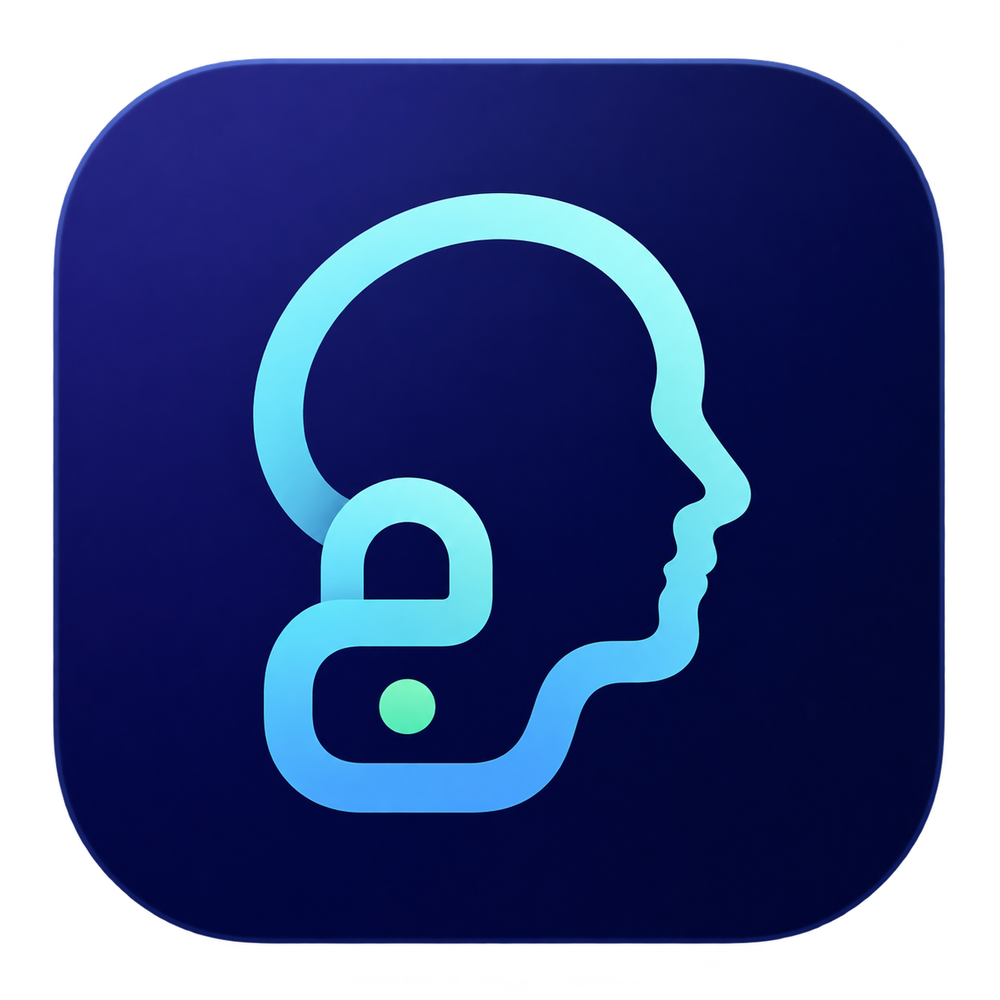

# MacFace

用人脸解锁 macOS 原生锁屏。支持自动刷脸和空白回车刷脸，识别在本机完成，无需保存系统密码。

**系统要求**：Apple 芯片、macOS 27。当前正式版使用外接 USB 摄像头。

[下载安装包](https://github.com/gycodex/MacFace/releases/latest)

## 开始使用

1. 安装并打开 MacFace，允许摄像头权限，按提示录入人脸。
2. 选「自动刷脸」或「回车刷脸」。自动刷脸需要给 `MacFaceAgent.app` 开启辅助功能权限。回车刷脸在锁屏密码框留空按回车。
3. 按 `⌃⌘Q` 锁屏。系统密码仍可直接解锁。

安装包未签名、未公证。源码采用 [MIT](LICENSE)，第三方许可见 [THIRD_PARTY.md](THIRD_PARTY.md)。
